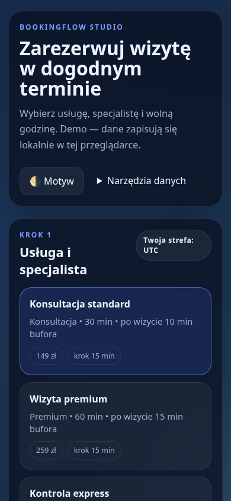

# BookingFlow Studio

BookingFlow is a browser demo for choosing an appointment time, booking it, and managing a local waiting list. It is a single-user portfolio project: there is no server, account system, or real email delivery. Data stays in this browser's `localStorage`.

## Try the demo

Serve the repository over HTTP because the app uses ES modules:

```bash
npm ci
npm run build
python -m http.server 8000 --directory _site
```

Use Node.js 24.16 or later and Python 3 for the commands above. Open http://localhost:8000. Pick a service and specialist, choose a day and available time, then enter the demo customer's details. Use **Moje rezerwacje** to find a booking by email and cancel or reschedule it. Other tabs show the waiting list, simulated outbox, and operational metrics.



The screenshot is captured from the running app at a 390 × 844 viewport by the browser regression suite.

## What it demonstrates

- Time-zone-aware availability with working hours, breaks, appointment buffers, and conflict checks.
- Booking, rescheduling, cancellation, and wait-list promotion, with email represented by a local outbox.
- JSON backup and restore. Imports are checked for supported schema versions, valid records, dates, IDs, and service/specialist references before they can replace the current state.
- Storage recovery. When storage is blocked or full, the app keeps working in the current tab and displays that changes are temporary. A damaged saved value is never replaced by ordinary edits. Explicit recovery saves a byte-for-byte copy under a separate recovery key before replacing the active value. A changed value from another tab or a failed backup blocks recovery. Export session changes before closing the tab.
- Keyboard-accessible tabs, responsive layouts, and light/dark themes.

## Checks

```bash
npm test
npm audit
npm run build
node --check app.js
```

The unit tests cover date/time-zone helpers (including missing and repeated daylight-saving hours), slot generation, nested import validation, quota failures and preservation of corrupt storage. The browser suite serves the exact `_site` directory used by the Pages workflow and creates and reschedules a booking, tests invalid import preservation and quota recovery, checks keyboard tabs and mobile overflow, and runs axe on the booking screen.

```bash
python -m venv .venv-e2e
. .venv-e2e/bin/activate
python -m pip install -r e2e/requirements.txt
python -m playwright install chromium
python -m pytest -q e2e
```

Set `PLAYWRIGHT_CHROMIUM_EXECUTABLE_PATH` if Chromium is installed outside Playwright's browser directory.

Chromium's sandbox stays enabled. CI uses the Ubuntu runner's system Chrome;
local containers must permit its sandbox and loopback server to start.

Validation on 2026-11-12: a clean `npm ci`, 56 unit tests, the static build and
3 browser scenarios on `_site` passed with Node 24.19 and sandboxed Chromium.
The dependency audit reported zero findings. CI also checks all dependency
advisories, JavaScript syntax, CodeQL security queries and Git history secrets.
Remote check results must be verified on the final PR commit before merging.

## Data and deployment limits

Local email lookup is a convenience for this demo, not identity verification. Do not enter real customer information. Clearing browser storage removes bookings; a successful JSON export is the portable backup. The repository includes a GitHub Pages workflow, but no hosted deployment is verified here.

## Main files

`app.js` connects the screens and actions, `storage.js` manages persistence and recovery, `dataStore.js` validates stored and imported data, `availability.js` computes slots, and `dateUtils.js` handles date and time-zone operations. The pure modules have focused Vitest coverage; DOM behavior is exercised with Playwright.
